# MundusMaker — DM workflow audit

Completed 13 September 2026.

MundusMaker can support a complete small-campaign prep session. Its strongest parts are local persistence, linked lore, readable character sheets and secret filtering. The main remaining difficulty is moving from created content to a compact, reliable workspace at the table. Prioritize the player-map GOAL label, clipped map controls and unfinished character choices before expanding the feature set.

Continuous isolated walkthrough begun on 11 September and completed on 13 September 2026. The first map and lore steps used 1.8.0; the run resumed on 1.8.1 after the separately authorized Mac/Docker patch. The desktop prep workflows audited here were not changed by that patch. All campaign content was created through the UI in a fresh isolated Edge profile at localhost:4981, using tmp/dm-audit-2026-09-11/data. The user’s real data/ was not used for the walkthrough. No usability fixes or 1.9.0/2.0.0 roadmap changes were made during this audit.

[Open the illustrated report](index.html) for all 33 screenshots and rendered PDF checks.

## Scenario

The Bell Beneath Blackwater: 19 entries, four maps, one D&D character advanced to level 2, one recurring festival, one session, two handouts and five DM Screen pins.

## Walkthrough

| Step | Task | Health | Result |
|---|---|---|---|
| 1 | Start a new world | Works with setup friction | The sample and new-world flow worked. Eleven empty category cards precede the first useful prep actions. Screens 01, 02. |
| 2 | Create categories and linked lore | Works with friction | Created Gods and Quests, people, factions, a clue and a quest. Links help; category ordering, cramped quick-create and generic field hints slow authoring. Screens 03, 04, 05, 06. |
| 3 | Build world → region → town | Needs work | The coast and settlement names carry through this seed. The editor clips controls, ancestor navigation is weak, and generated town places need separate wiki markers. Screens 07, 08, 09, 10. |
| 4 | Prepare a two-floor dungeon | Needs work | Crypt generation and floor switching work. Numbered rooms lack a matching notes key, and player PNGs retain GOAL labels. Screens 11, 12, 13, 14. |
| 5 | Create and level up a D&D character | Works with gaps | Tessa’s AC, HP, skills and level-up worked. Some choices still require free text or remain unresolved. The standard sheet is readable. Screens 15, 16, 17, 18. |
| 6 | Schedule the festival | Works after setup | Defined twelve months and a recurring festival. The clock advances correctly, but scheduling crosses Calendar, an Event entry and Timeline. Screens 19, 30. |
| 7 | Prepare the encounter and DM Screen | Works with friction | Damage, undo, turn order, persistent session state and rule pins work. Long cards make it harder to scan the board during play. Screens 20, 21, 22, 23, 33. |
| 8 | Make handouts and a player packet | Works with gaps | The letter and card export to PDF and images. Linked card text has awkward order; leaving the list clears packet selections. Screens 24, 25, 26. |
| 9 | Review player visibility and exports | Needs attention | Test secrets were excluded from UI and PDF. Generated GOAL labels remain in the player map, so the player-safe promise is too broad. Screens 27, 28, 29. |
| 10 | Save, reopen and back up | Works in this test | Reload retained the world, level, clock, encounter and five pins. The downloaded backup contains all 19 entries and four maps. Screens 30, 31, 32, 33. |

## Difficulties

Suggested directions below are findings for later planning, not implemented changes or a version roadmap.

### F01 · High · Player-safe dungeon maps still reveal the goal

Steps 4, 9; screenshots 14, 28, 29.

**Observed:** I selected L2 in The Sunken Chapel and exported PNG · player-safe. The image retains GOAL, IN and room numbers. GOAL is also visible in player preview and in the campaign PDF’s embedded map. The secret Reliquary marker is correctly absent.

**Impact:** A DM can unintentionally point the party at the destination while using an export explicitly labeled safe for players. This is generated guidance leaking adventure structure; it is not a failure of the user-marked secret flags in this test.

**Suggested direction:** Exclude generator guidance such as GOAL from player output. Give the GM a clear choice about room numbering and other map annotations before sharing.

### F02 · High · The map editor does not fit the tested laptop viewport

Steps 3, 4, 9; screenshots 07, 10, 28.

**Observed:** At 1365 × 900, the persistent world sidebar, canvas and settings panel exceed the usable width. Controls at the right edge are clipped. The player view retains a large column of disabled generation controls.

**Impact:** Map work requires scrolling and careful targeting instead of keeping the map and relevant controls together. Small generated labels compete with the surrounding UI.

**Suggested direction:** Let the map occupy more of the workspace, make its panels fit or collapse, and give player preview a presentation layout. Verify this at common laptop widths and browser zoom levels.

### F03 · High · D&D creation still leaves important choices to the DM

Steps 5; screenshots 15, 16, 17, 18, 32.

**Observed:** Fighting Style is a structured choice, while Weapon Mastery uses a free-text notes field inside a feature. I entered Greatsword, flail and spear myself. Training still prints Gaming set of your choice after I specified Dragonchess Set in inventory and notes. Review & finish showed a checkmark before earlier choices were complete.

**Impact:** The creator can produce a playable sheet, but a DM must understand which selections are unfinished and manually reconcile them. The completion signals do not fully establish that the character is ready.

**Suggested direction:** Use structured choices with relevant rules and a final unresolved-choice checklist. Carry selected equipment and tool proficiency consistently into the sheet. Keep the successful level-up review and HP calculation.

### F04 · Medium · The map chain is stronger than the map-to-lore workflow

Steps 2, 3; screenshots 06, 08, 09, 10.

**Observed:** The Bell Coast inherited the recognizable coast and Blackwater’s name. The editor offers a back link to the current entry, but no visible world → region → town breadcrumb. Clicking the generated Lantern Inn label did not open a linked location. I placed a separate Harbor office marker for Mara, whose label overlaps Customs House in the town export.

**Impact:** The map looks inhabited before its places are useful campaign entries. The DM must add and maintain a second set of markers and remember where a drilled map belongs.

**Suggested direction:** Make generated places easier to turn into linked locations, surface their associated people and clues, and provide ancestor navigation. Preview inherited terrain and settlement size at drill time; Blackwater started as a desert metropolis without such a review.

### F05 · Medium · Dungeon geometry needs a room-preparation companion

Steps 4; screenshots 11, 12, 13.

**Observed:** The tested crypt has a dominant straight corridor and repeated chambers on both floors. Room numbers are visible, but I found no corresponding room-key list for descriptions, clues or encounters. Increasing the level count previews the current floor rather than the newly requested one.

**Impact:** Generation saves drawing time, but leaves much of the work of making this particular dungeon ready to run. The second floor cannot be judged until after applying the change.

**Suggested direction:** Pair generated rooms with editable prep notes and preview each requested floor. Explore stronger visual and structural differences within a dungeon. This finding covers the tested crypt seed, not every dungeon style.

### F06 · Medium · Session references are too tall for quick scanning

Steps 7; screenshots 20, 21, 22, 23, 33.

**Observed:** I pinned Frightened, Blinded, Mara, the session and the chapel. Full entry text and long attribution passages push the session notes below the initial screen. The board is per world, with no visible session-specific layout. Encounter conditions are a free-text reminder.

**Impact:** I had to scroll to move between rules and the notes needed for the opening scene. The tested two-combatant encounter worked; larger encounter performance and density were not tested.

**Suggested direction:** Offer compact reference cards, collapsible source details that preserve attribution, session-focused pin collections and condition-to-rule shortcuts. Preserve the working damage undo and separation from source character HP.

### F07 · Medium · Linking a handout source produces awkward print order

Steps 8; screenshots 24, 25.

**Observed:** Selecting Saltglass Key as the item card’s source retained the template’s unrelated brass-key and observatory text until I cleared it. The saved card repeats Saltglass Key as a heading, and the linked description appears after the custom footer. The separate letter layout is clear and exports cleanly.

**Impact:** The DM must clean up sample prose and work around the appended source section to get a natural-looking card. Unrelated sample text could be printed accidentally.

**Suggested direction:** Let source properties populate or be placed within the template, with an explicit choice about replacing sample content. Keep a real footer after the body, and avoid an unnecessary repeated title.

### F08 · Medium · Handout packets are temporary selections

Steps 8; screenshots 26.

**Observed:** I selected both handouts, opened the item card to check it, and returned. Both Include in packet checkboxes were cleared. Selection order also has to be rebuilt. Preview edition and export edition are separate controls on the editor.

**Impact:** Checking or revising a handout interrupts assembling the packet. A DM preparing next week’s materials cannot rely on that selection remaining ready.

**Suggested direction:** Save named packets or a packet attached to a session, retain selections during editing, and show the actual export edition prominently at the final action.

### F09 · Medium · Campaign organization takes too much small-scale editing

Steps 1, 2; screenshots 02, 03, 05, 06.

**Observed:** The new world starts with eleven equally prominent empty categories. Gods and Quests append at the bottom and move one position per click. The sidebar name field is about 45 px wide. Quest Status inherits the character-oriented Alive, dead, missing? hint. Relations use a label and an alphabetical native dropdown.

**Impact:** Basic prep is possible, but the interface requires many small adjustments before the world reflects this campaign. Long names are difficult to enter in the sidebar, and custom categories do not feel fully customized.

**Suggested direction:** Bring initial prep actions forward, offer easier category ordering and a usable name field, and let custom field hints follow the category. Make related people and places easier to browse together. This audit used 19 entries, so claims about hundreds of entries remain untested.

### F10 · Medium · Scheduling begins with configuration rather than the campaign’s events

Steps 6; screenshots 19, 30.

**Observed:** Calendar opens on month and age setup. I defined twelve months, opened a separate Event entry to date the festival, and used the dashboard clock for upcoming timing. Advancing 12 → 13 Lanternfall correctly changed the festival from in two days to in one day.

**Impact:** The clock is useful once configured, but a DM has to cross several surfaces to schedule and review an event.

**Suggested direction:** Provide a usable starting calendar and a clear event view with creation from a date. Keep the tested recurring-event and clock arithmetic behavior.

### F11 · Medium · Campaign PDFs need stronger pagination and map presentation

Steps 5, 9; screenshots 29.

**Observed:** The 13-page player campaign PDF leaves the Locations heading at the bottom of physical page 2, separates The Bell Coast’s heading from its map, and splits the deity’s quick facts across physical pages 7 and 8. The world and region maps share one portrait page. Tessa’s separate four-page character sheet is readable, with a clear statistics page.

**Impact:** The booklet is usable, but headings and content can become disconnected. Small map labels are harder to read at normal print size.

**Suggested direction:** Keep headings with their first content, avoid splitting short fact groups, and offer dedicated map pages. An optional shorter character appendix could help DMs who already know the feature rules.

### F12 · Medium · Several controls need accessibility and consistency work

Steps 2, 3, 9, 10; screenshots 05, 10, 27, 28, 30.

**Observed:** DOM inspection found the GM/player checkbox has display:none and no text or aria-label; the visible label comes from CSS, so it is absent from the checkbox accessibility tree and normal keyboard focus. Six marker color swatches lacked accessible names, and quick-fact inputs shared a dash name. Player map preview also prints a literal null, while the world summary stayed at 12 entries until reload updated it to 19.

**Impact:** Some controls are difficult to identify or operate without a pointer, and stale or stray text reduces confidence in saved state.

**Suggested direction:** Use a focusable, named GM/player control and meaningful names for swatches and fields; check focus behavior and zoom. Remove stray text and update counts after creation. This is a targeted accessibility observation, not a full compliance assessment.

## What worked

- The complete prep scenario could be finished without editing campaign JSON or installing application dependencies.
- Custom categories, wiki links and typed relationships connected a coherent cast, faction conflict, clue, deity and quest.
- The tested world-to-region coastline and inherited settlement name were recognizable. Town wards, quays, gardens and a market give Blackwater useful visual character.
- Tessa’s level 1 → 2 advancement raised HP from 13 to 22, retained AC 17, and added Action Surge and Tactical Mind. The printed main statistics page is clear.
- Encounter damage and undo worked. After reload Tessa remained 17/22 in the encounter and 22/22 on the character sheet; the active turn and reminder also persisted.
- The DM Screen supplied searchable references for D&D, Vampire V5 and Call of Cthulhu. Two D&D rules were pinned successfully.
- The letter PDF matched its preview, and the mixed letter/card packet produced a readable two-page PDF and a valid two-image ZIP.
- Player filtering removed the four GM-only entries, tested secret prose and two secret map markers. Direct hidden-entry and DM Screen routes showed access notices.
- Reloading retained the world, 13 Lanternfall clock, character, encounter and five pins. Settings reported six valid map links across the isolated test world and sample world.

## Test outputs

- [Player campaign PDF](evidence/exports/blackwater-campaign-player.pdf) — 13 pages; generated before the clock advanced from 12 to 13 Lanternfall. Contains the reported GOAL label in dungeon images.
- [Letter + item card packet](evidence/exports/blackwater-handout-packet-player.pdf) — Two pages; player edition; secret letter annotation omitted.
- [Handout page images](evidence/exports/blackwater-handout-images-player.zip) — Two PNGs; archive CRC passed. This is test handout output, not an alternative app distribution.
- [Tessa’s level-2 sheet](evidence/exports/tessa-brine-level2-player.pdf) — Four pages; standard D&D format; AC 17 and HP 22.
- [Player dungeon PNG](evidence/exports/chapel-lower-player-final.png) — Secret Reliquary marker absent; GOAL remains visible.
- [Player town PNG](evidence/exports/blackwater-player.png) — Public Mara marker visible; secret Choir marker absent.
- [Complete test-world backup — GM only](evidence/exports/blackwater-world-backup.json) — 19 entries, four maps, calendar and five pins. Contains intentional test secrets; not for players.

## Limits

- One synthetic campaign, one D&D Dwarf Fighter advanced from level 1 to 2, four maps and a 1365 × 900 desktop viewport. This is an experienced-DM walkthrough, not a study with a representative group of DMs.
- World, region, coastal town and two-floor crypt paths were exercised. Other terrain seeds, town archetypes, cave/mine/sewer styles, interiors, and large edited maps were not comprehensively tested.
- The creator used bundled options. Imported 5etools packs, higher levels, spellcasting, subclasses, multiclassing and VTM/CoC character advancement were not covered here. VTM/CoC reference filters were inspected, not played through.
- Letter and item card templates were exercised. Old-book, scroll, poster, custom illustration, seal and non-Latin-font workflows were not covered.
- The player campaign PDF was text-checked for the canaries and rendered for visual review. Text extraction alone cannot inspect raster maps; those were checked visually, including the remaining GOAL label.
- The downloaded backup contains 19 entries, all four map definitions, the calendar and five pins. Include images was selected, but this campaign has no uploaded assets, so an image backup/restore round trip was not tested. The backup itself is a GM backup containing secrets, not a player handout.
- Reload and persistence were tested. A restore into another world, another device, concurrent editors, NAS deployment and long-term recovery were outside this walkthrough.
- Accessibility observations combine screenshots and targeted DOM inspection. There was no full keyboard-only journey, screen-reader test, contrast audit, mobile test, browser-zoom matrix or WCAG conformance assessment.
- An initial Edit-button interception was observed, with clicking prose as a workaround. It was not generalized into a confirmed product defect. The mastery-field screenshot has the field below the fold; its behavior is supported by the DOM and the completed sheet.

## Mac and NAS patch

The separately authorized tester patch is complete as MundusMaker 1.8.1. It corrects a JXA/Cocoa null-bridging bug matching the reported -[NSNull count] startup error, and adds optional authenticated Docker/NAS hosting with persistent storage. One universal ZIP retains Windows, Linux and Finder/.command Mac launchers with all five bundled runtimes. Archive CRC, exclusions, Unix execution permissions, packaged Mac fix presence and packaged Windows startup passed. Gateway behavior and persistence were tested against the real Node backend, and the hosted UI was checked in an isolated browser. Native macOS startup and an actual Docker image build/NAS run remain unverified because those environments were unavailable. Anyone with the hosting password has full DM access; use a private VPN or HTTPS for access away from home.

[Universal 1.8.1 ZIP](../../../dist/MundusMaker-1.8.1.zip) · [Docker guide](../../docker.md) · [Release notes](../../1.8.1-release.md)

## Screenshot index

### 01-welcome

Fresh profile opens a populated sample world and an introductory modal. Initial loading frame was rejected and replaced by this stable capture.

### 02-empty-world

Creating an empty world worked. The dashboard gives equal visual weight to eleven empty categories; first-entry and character-creator actions are below them. No campaign-prep checklist or system choice appears.

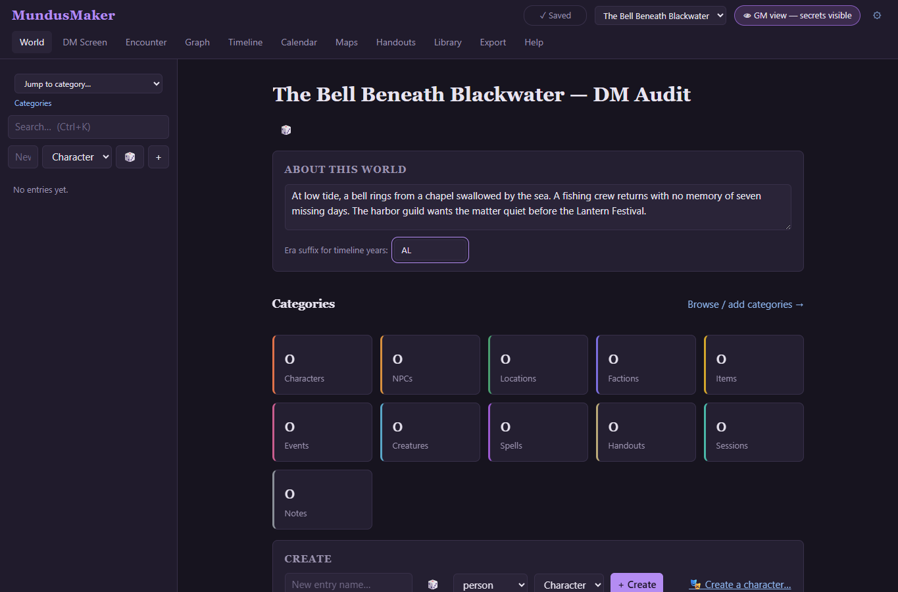

### 03-custom-categories

Gods and Quests were easy to create with suggested quick facts. New categories append at the bottom; only one-position Earlier/Later buttons are visible for reordering, so moving a category near the top would take repeated clicks.

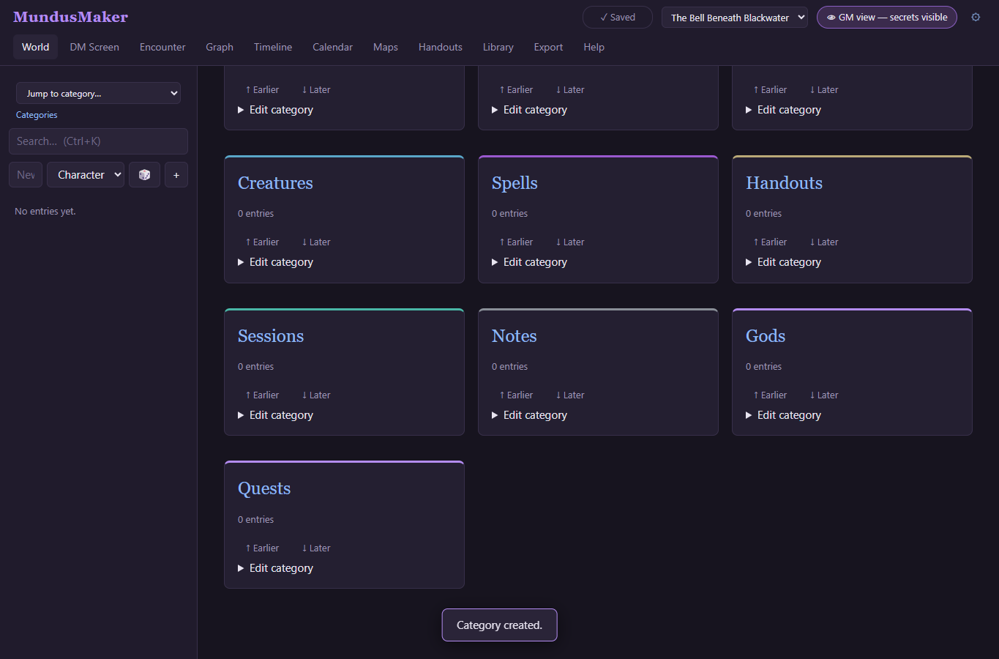

### 04-entry-editor

The entry exposes prose, multiple block kinds, quick facts, relations and map creation in one long page. During this run the explicit Edit button was intercepted by the text paragraph; clicking the prose opened editing. Treat the button behavior as a follow-up verification item, not a confirmed general failure.

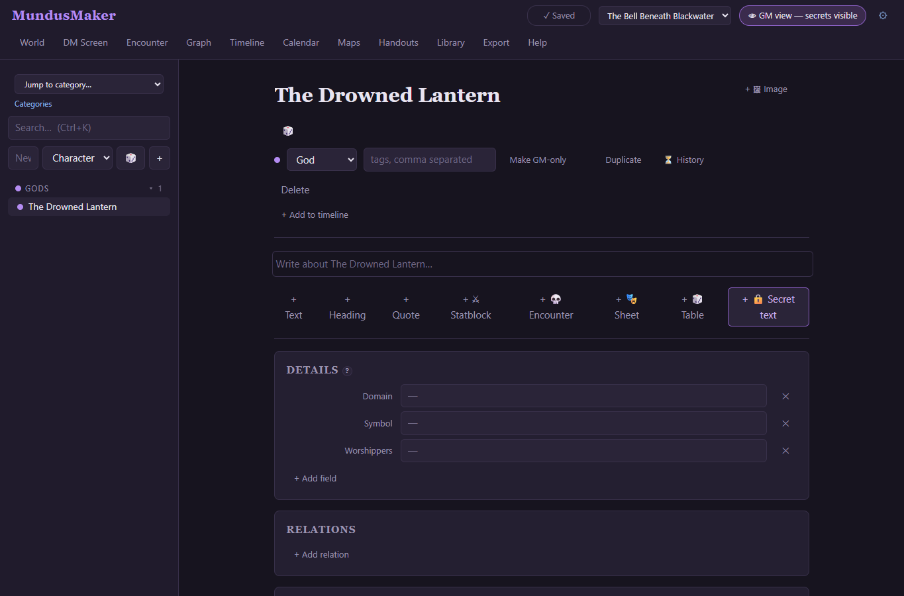

### 05-sidebar-quick-create

The new-entry name field in the sidebar is only about 45px wide at 1365px viewport; a normal NPC name is clipped to a few letters while the type and dice controls occupy most of the row. Quick-fact inputs have a shared dash accessible name rather than their visible field labels.

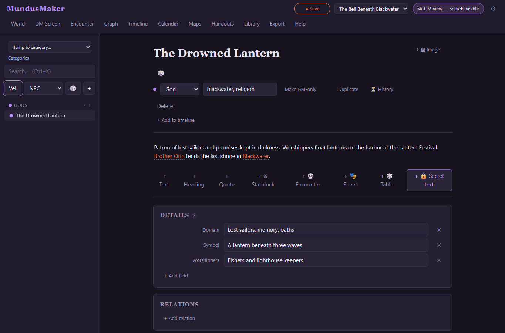

### 06-quest-and-relations

Writing wiki links connected existing entries and left recognizable create-on-click links for missing ones. Custom Quest Status inherits the generic helper Alive, dead, missing? and placeholder alive, missing, imprisoned, which is inappropriate for quest status. Relations require a separate label plus an alphabetical native target dropdown.

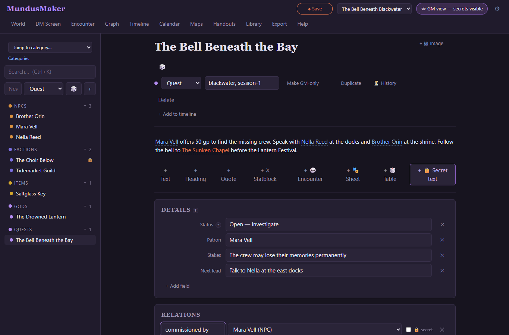

### 07-world-map

The new world was generated with default 1.8 settings. Controls, region links and settlements occupy a long side panel. I need a coastal capital called Blackwater, and must relate names in this panel to small labels on the map.

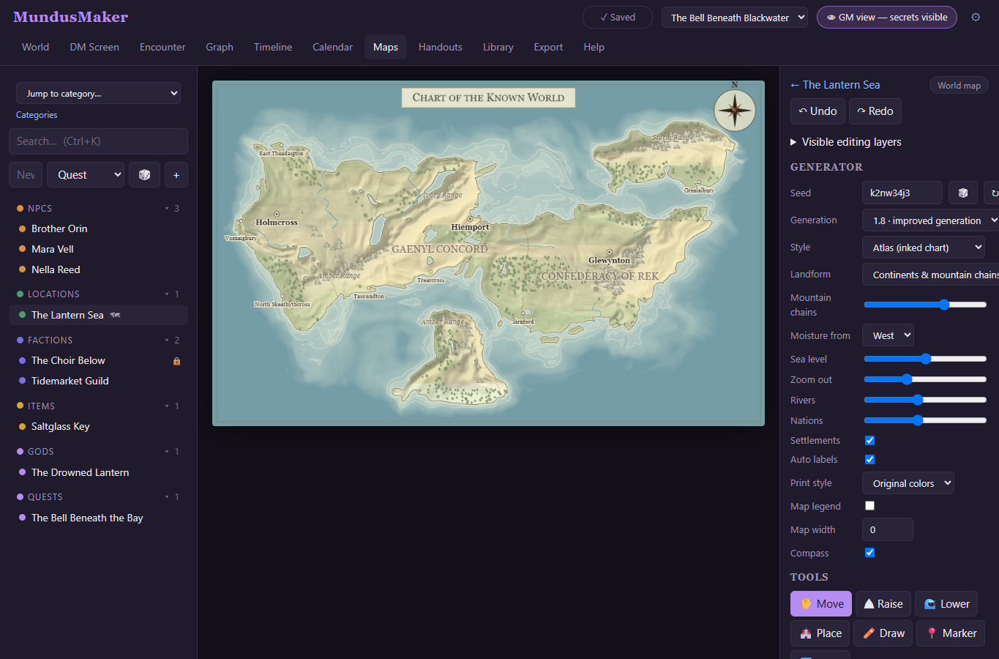

### 08-inherited-region

Creating a region asks a clear confirmation, then opens a region map with inherited settlement names. The entry name is The Bell Coast. The map editor has only a back link to the current entry, rather than a visible world→region breadcrumb.

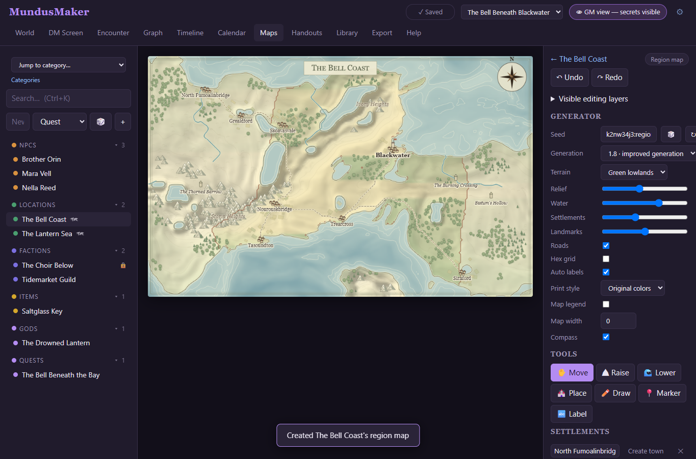

### 09-blackwater-town

The region-to-town drill inherited Blackwater’s name and coastal layout. The generated plan has meaningful wards, gardens, quays and a market, but the map starts without the campaign’s existing NPCs or clue locations attached. Its initial controls show Metropolis and Desert. A capital can reasonably be large; the difficulty is the absence of a drill-time review of size and terrain, especially beside the green parent region.

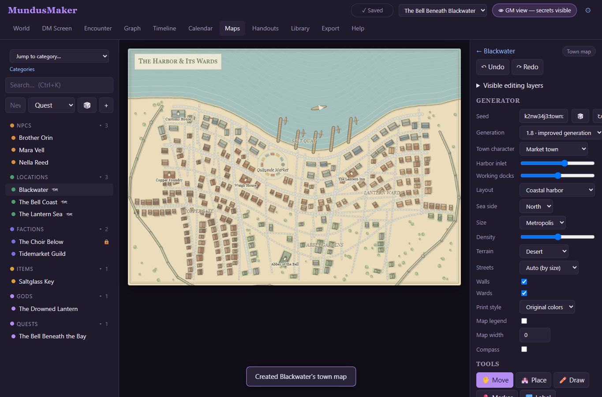

### 10-marker-tools

Clicking the generated Lantern Inn label did not open an entry or selection. To attach campaign characters I have to place a separate marker. The panel’s six color swatches have no accessible names, and its controls extend beyond the right viewport edge at this laptop width.

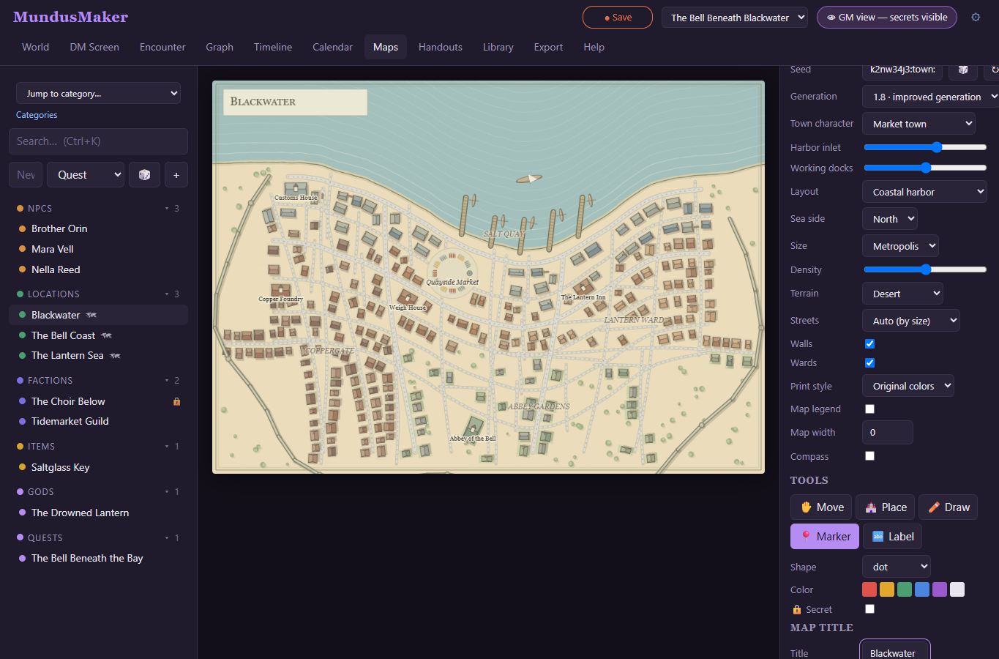

### 11-crypt-preview

The crypt style offers a side-by-side confirmation before applying. This makes regeneration understandable and reversible, but the preview labels do not explain which generated rooms, doors or stairs change.

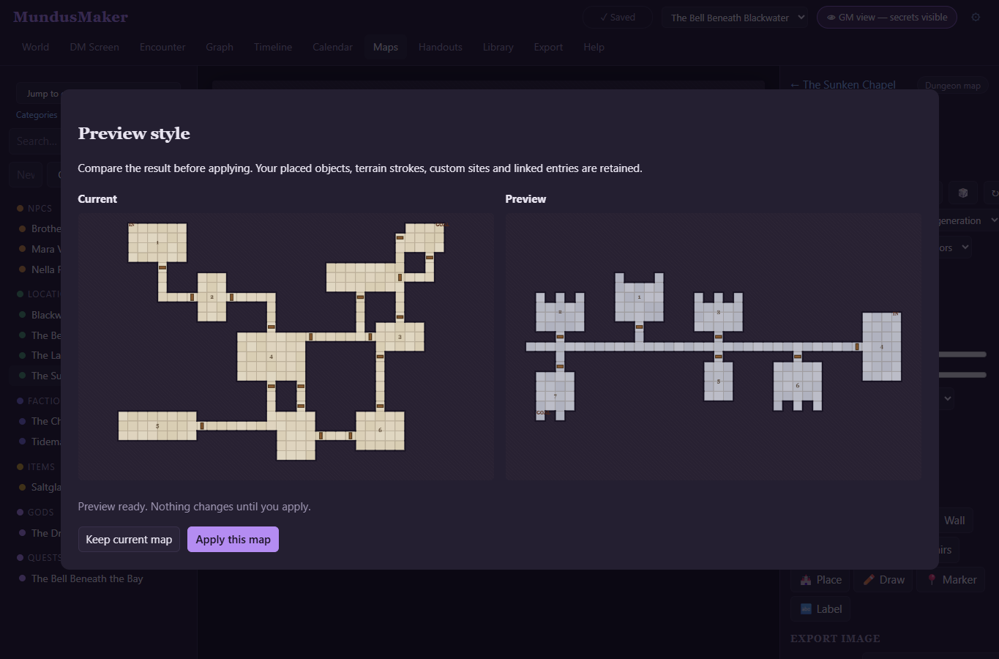

### 12-two-floor-crypt

The second floor was added successfully and a level switcher appears. Changing the floor count uses the same preview as other parameters, which previews only the currently displayed floor; it does not show the newly requested floor before applying. Room numbers exist on the image, but there is no visible room-key list for DM notes.

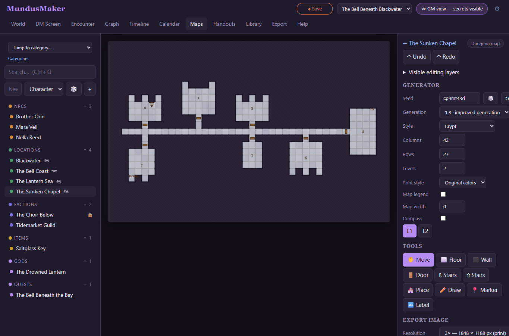

### 13-lower-crypt

The L2 switch opens the lower crypt with a visible stair landing. The editor remains a geometry canvas: there is no visible room-key or encounter-notes surface tied to the generated room numbers.

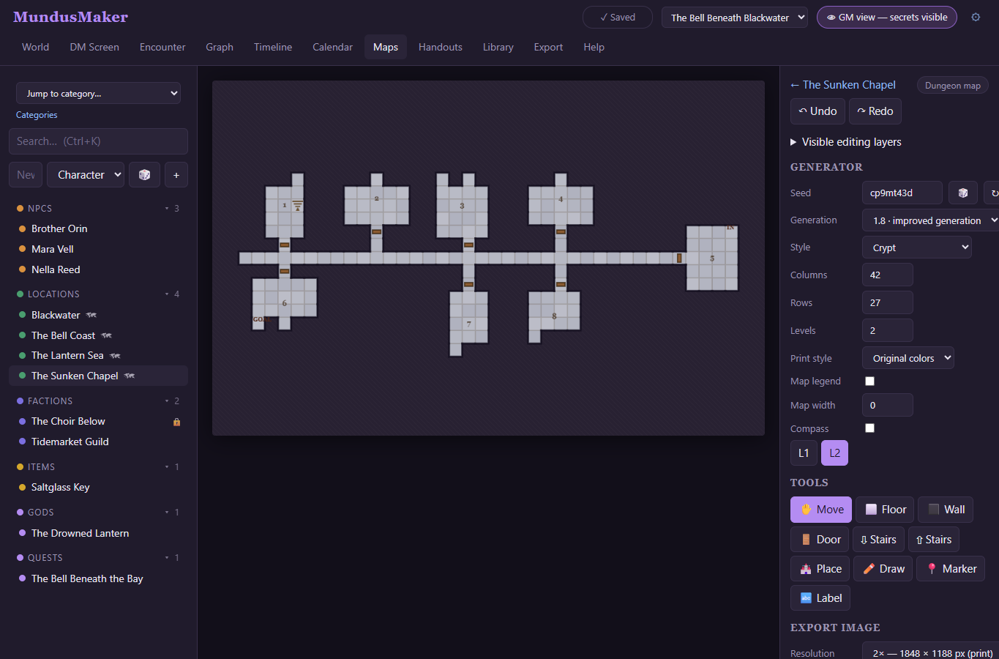

### 14-player-dungeon-export

The actual player-safe PNG still contains the generated GOAL and IN labels and room numbers. GOAL exposes suggested adventure structure even though it is not a user-marked secret; a DM annotation toggle or cleaner player map is needed.

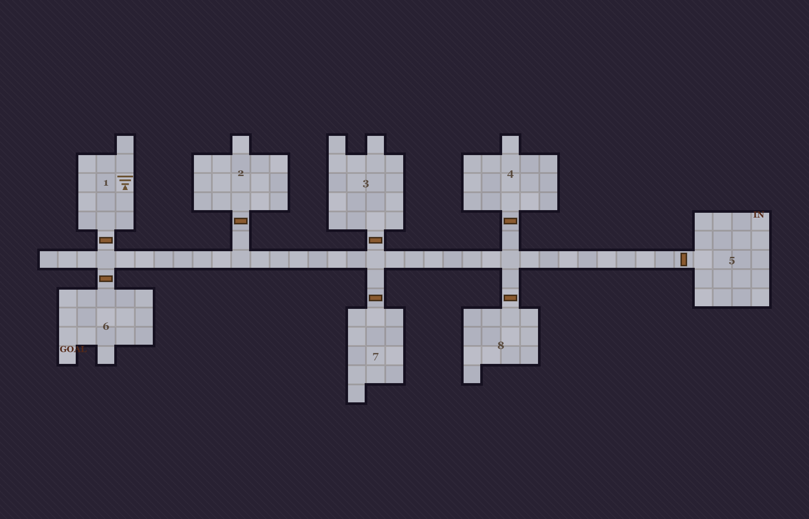

### 15-character-class

The class browser provides clear source filtering and a persistent character summary. The step navigation already shows Review & finish with a checkmark although no species, background or scores have been chosen, which makes completion status harder to trust.

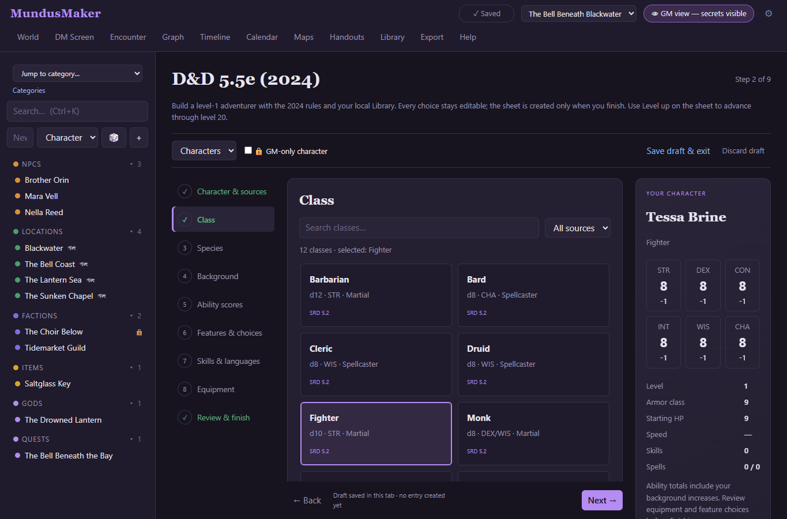

### 16-weapon-mastery-notes

Fighting Style is a structured choice, but mandatory Weapon Mastery selections are a free-text notes box inside a collapsed feature. A DM has to supply the three weapon names and understand their mastery effects without guided selection or validation here. Evidence limit: this viewport shows the opened feature area; the notes field itself was verified through the DOM and by entering the three weapon names, but is below this screenshot’s fold.

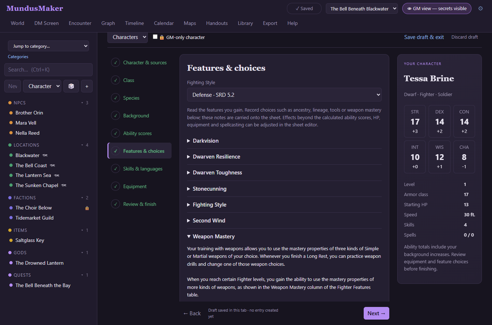

### 17-created-sheet

The creator produced one playable sheet with AC 17, HP 13, correct chosen skill bonuses, inventory and recorded mastery notes. Tool proficiency still says Gaming set of your choice after I specified Dragonchess Set in equipment and notes. Character backstory mentions remain inside the sheet, while the separate entry Background and Goals & bonds sections are empty.

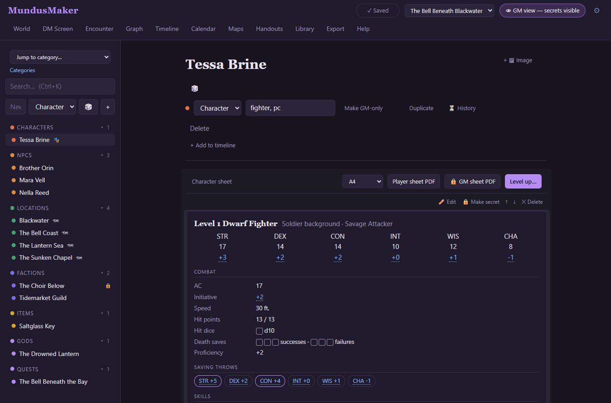

### 18-level-up-review

The level-up review correctly shows HP 13 → 22 (+9), including the dwarf’s extra HP, and adds Action Surge and Tactical Mind. It clearly requires review before Apply, but opens within the full manual sheet editor, whose many editable fields make this more crowded than the creator.

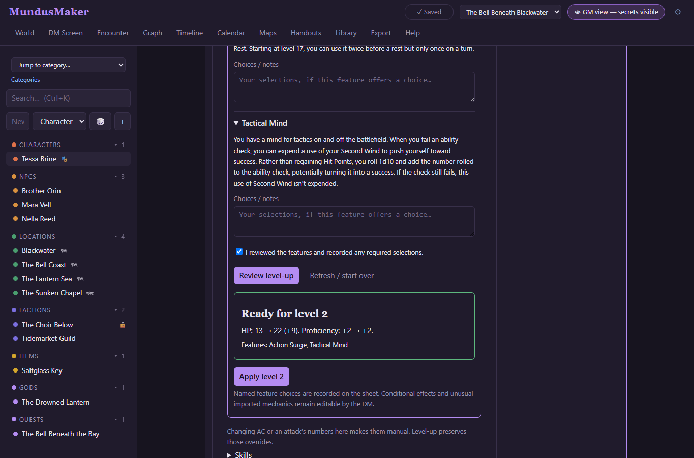

### 19-calendar-setup

Calendar opens as a configuration form with no named months, rather than a view of upcoming campaign events. Scheduling the Lantern Festival requires defining months here, then leaving for an Event entry and its date controls. The form explains that split, but it adds setup and navigation work.

### 20-session-encounter

A prepared session and its Encounter workspace share the tracker. Adding Tessa copied her level-2 HP (22); applying 5 damage showed 17 and Undo restored 22. Linked entry access is clear. Each combatant is a tall card, and conditions are free text with no rule shortcut, so larger combats will require more scrolling and lookup.

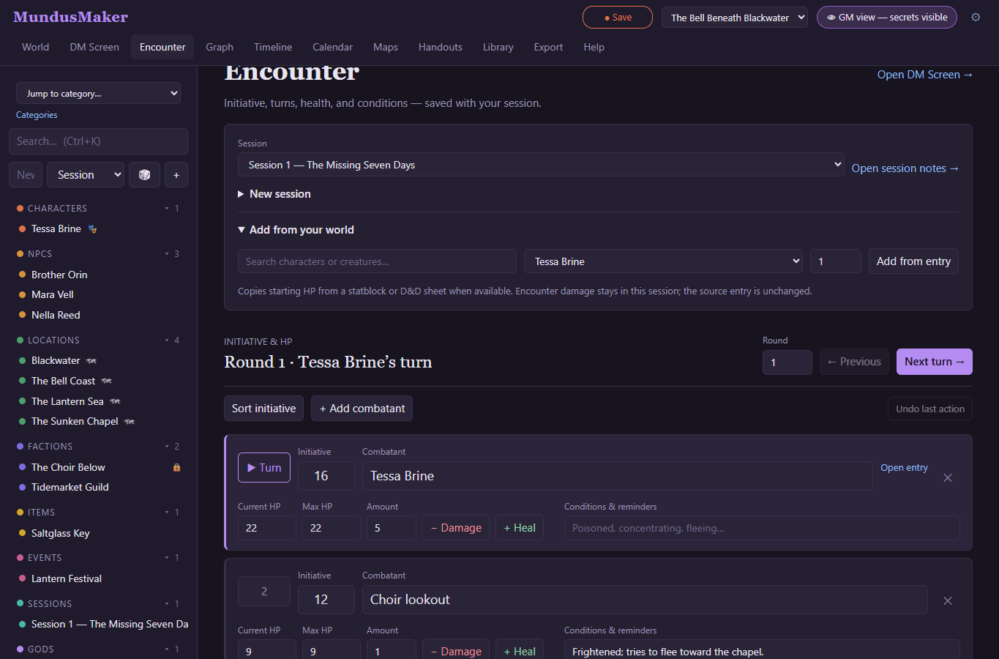

### 21-reference-systems

The ready-written library includes D&D, Vampire V5 and Call of Cthulhu filters. I pinned Frightened and Blinded for this campaign, and inspected the other systems without adding unrelated rules. Search, topic filters and a preview are useful; rules create ordinary editable GM-only notes.

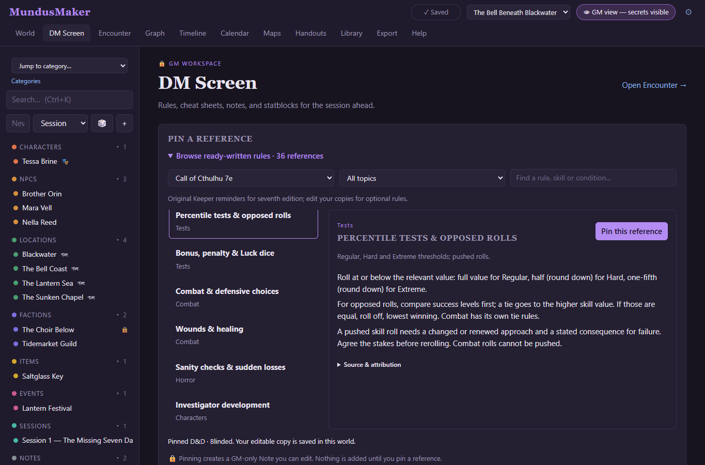

### 22-pinned-dm-screen

Rules and campaign entries pin correctly and retain links to their source entries. Long rules attribution and full entry text compete for space. With five pins the board needs substantial scrolling, and there are no visible per-session boards, compact modes, or free placement controls.

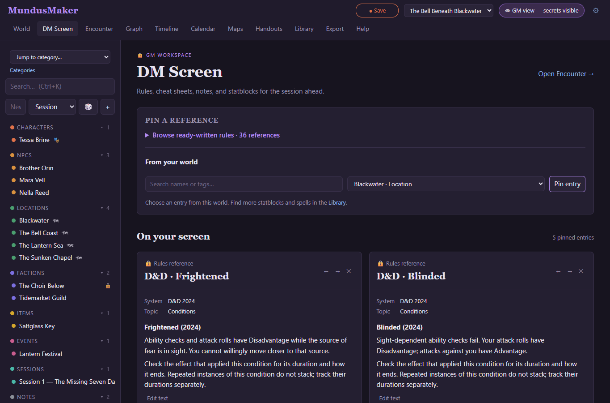

### 23-session-pins

The pinned session retains its linked people, places and clues. Reaching these notes takes scrolling below the rule cards and their attribution. A compact session-first arrangement would reduce lookup time during play.

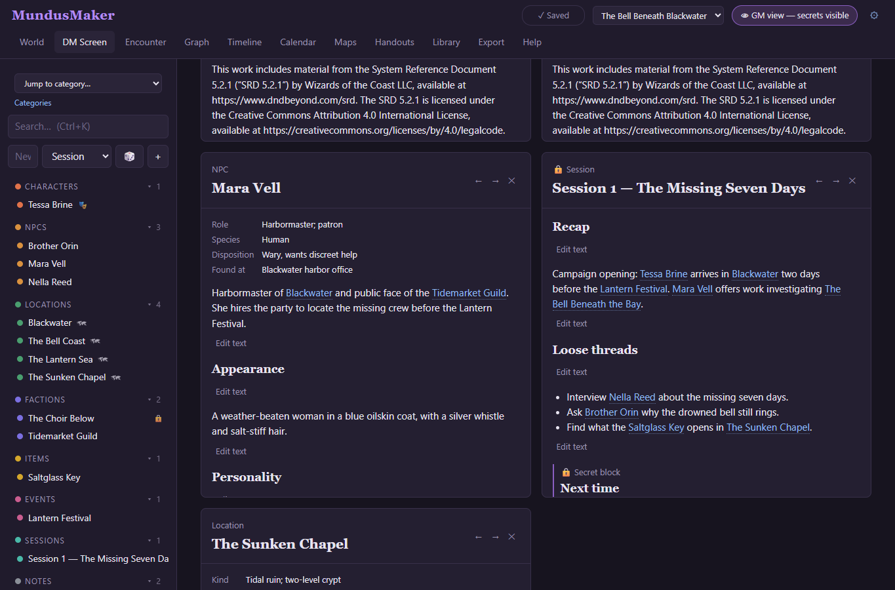

### 24-letter-preview

Authored a one-page Letter with sender, campaign date, body and signature, parchment and a fine border. Added a secret GM annotation; player preview displays the public letter without it. Separate preview and export edition controls need attention when switching.

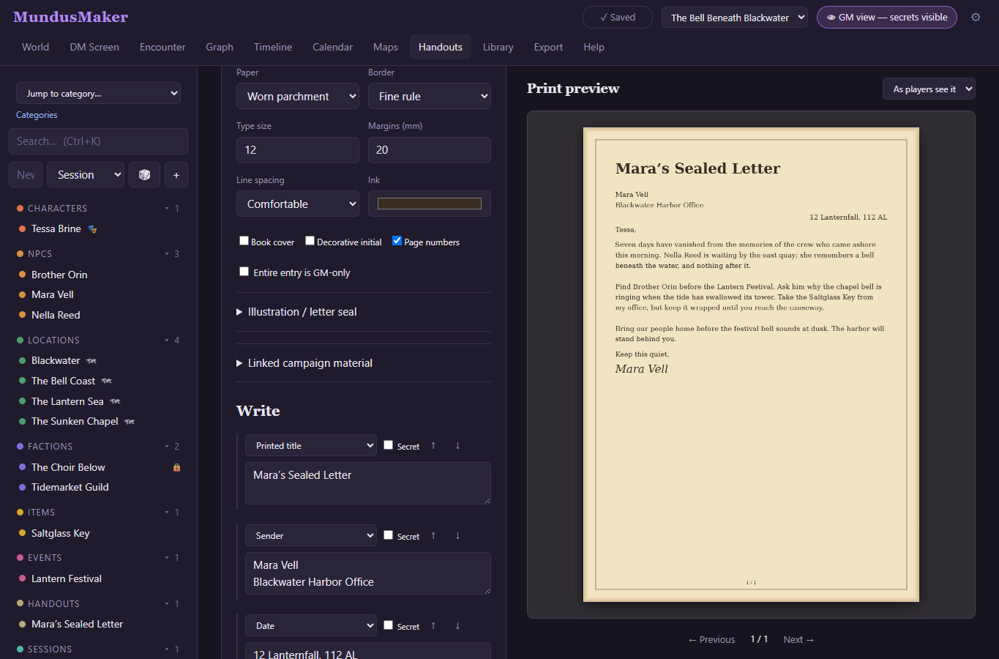

### 25-linked-item-card

Saved Item card links to the existing Saltglass Key entry and includes its selected public description. Choosing a source leaves sample brass-key/observatory text in place until manually cleared. The source entry title repeats under the custom footer; the source content comes after the footer.

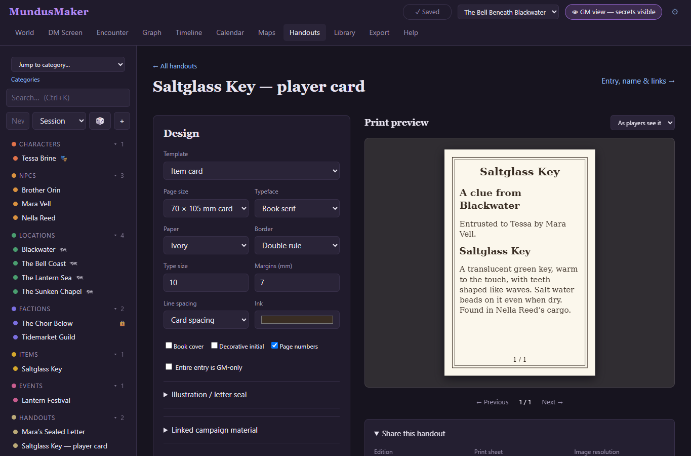

### 26-handout-packet

Selected a letter and linked item card for a player PDF and image packet. Leaving the Handouts list to inspect a card and returning clears packet selection/order; it is not a saved session packet.

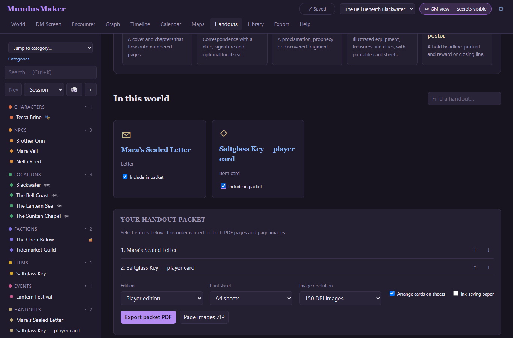

### 27-player-world

Player preview hides the four GM-only entries, including the Choir Below, Session 1 and both rule notes. Public sidebar and dashboard remain readable, and the campaign clock shows the festival in two days. The world-picker summary still shows an older entry count until reload.

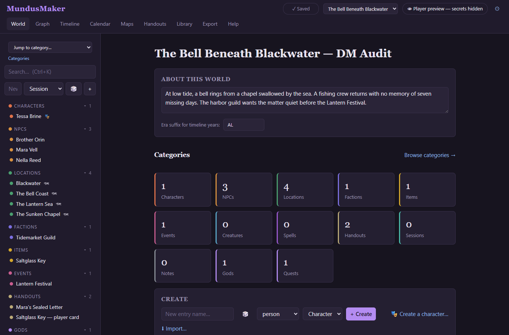

### 28-player-crypt

Player preview correctly omits the secret Reliquary marker, but generated IN, GOAL and room numbers remain on the lower-floor map. The read-only map view still devotes a large side panel to disabled generator controls and shows a literal null beside the banner.

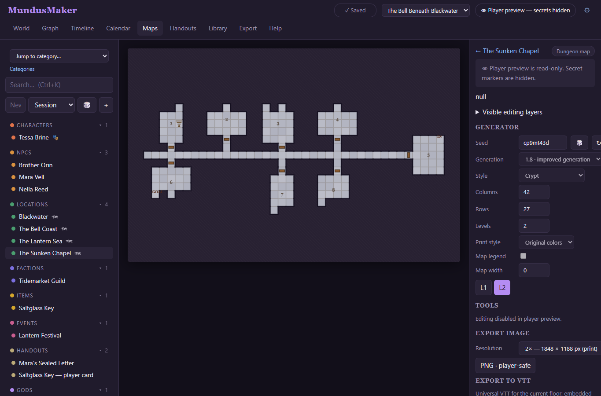

### 29-player-export-review

The export page clearly counts four hidden entries, thirteen secret blocks and two secret map items before generating the player edition. Standard character sheets, maps, timeline and relationships can be included. Direct player routes to the Choir Below and DM Screen showed only access notices.

### 30-campaign-clock

Advancing the campaign clock from 12 to 13 Lanternfall correctly moves the Lantern Festival from in two days to tomorrow. The clock is useful after calendar setup; scheduling still spans the Calendar configuration, an Event entry and Timeline.

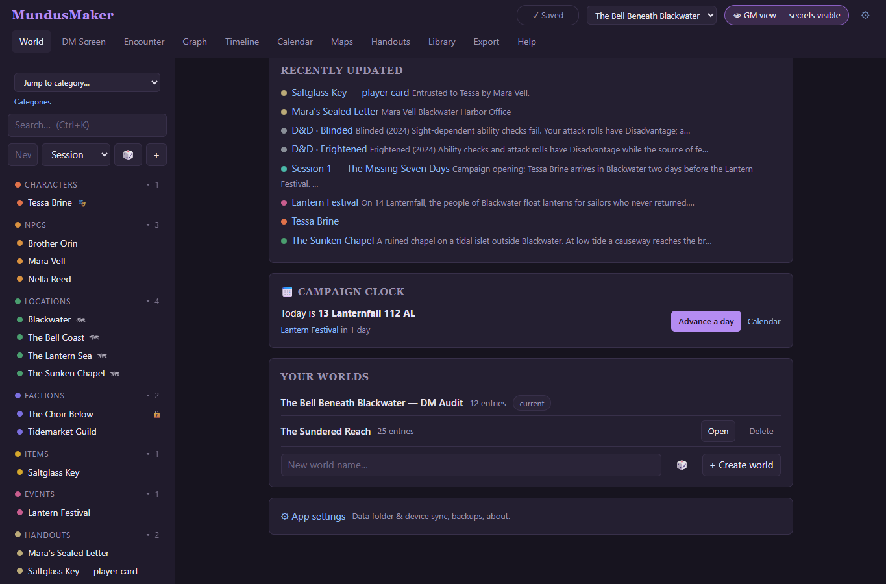

### 31-backup

Settings offers a current-world JSON backup and a separate Include images checkbox. The data folder points only to the isolated audit directory; map-link integrity reports no broken targets. Backups are separate from the Export tab used for player PDFs.

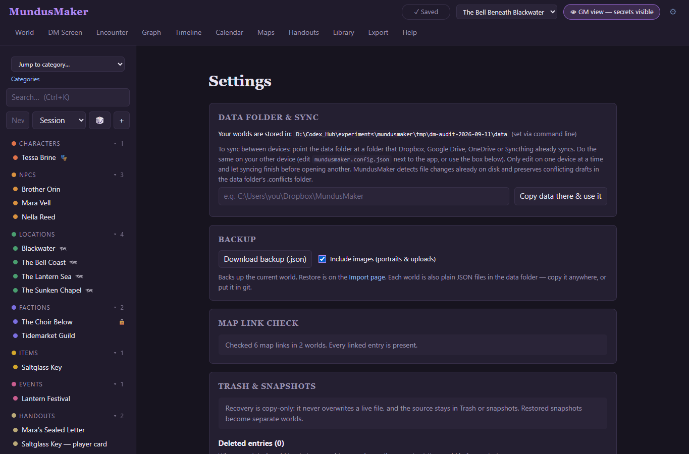

### 32-reopened-character

After reloading the app, the chosen world is retained and Tessa remains a level-2 Dwarf Fighter with AC 17 and 22/22 HP. The campaign clock remains 13 Lanternfall. The world summary refreshes to the correct 19 entries.

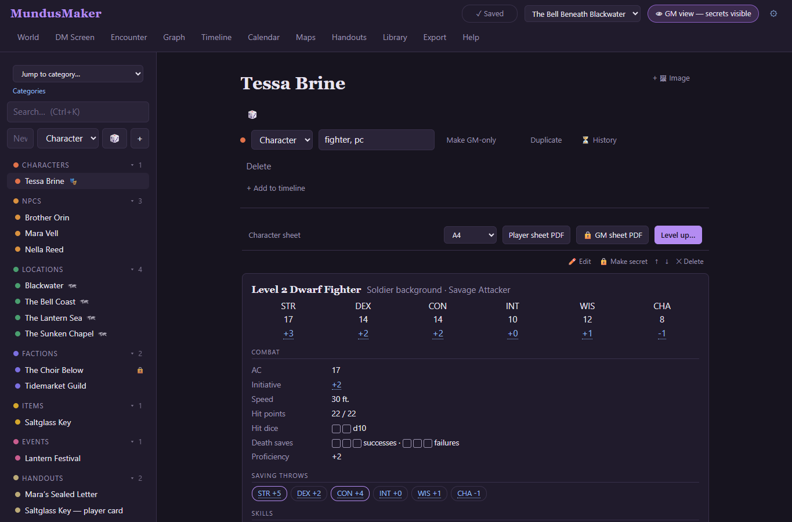

### 33-reopened-encounter

After reloading, Session 1 retains initiative order, the active Choir lookout turn, Tessa’s encounter HP of 17/22 and the lookout’s Frightened reminder. Tessa’s source character sheet remains 22/22; encounter damage does not modify the character.

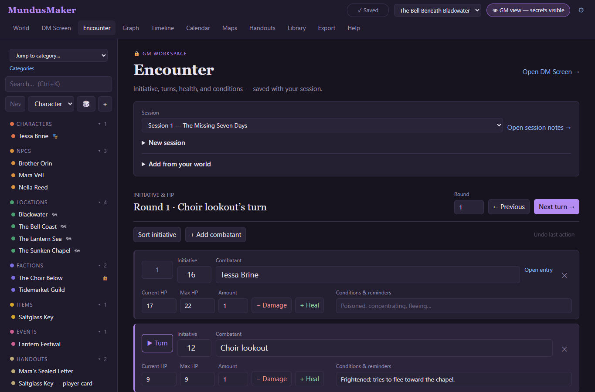
